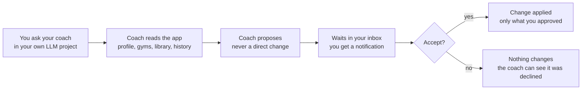

# Chalk and Iron: build specification package

16 November 2026 · Owner: Nathan

The living copy of this document is at https://claude.ai/artifact/2PQjcQy6EkoHzrdhJ1QDrK. This file is the copy the coding agent builds from.

## 1. How to use this package

Chalk and Iron is a personal weight-lifting tracker with three parts: a phone web app for logging workouts, a browser planner for building them, and a connector that lets each user's own LLM project act as their coach. An AI coding agent builds it under Nathan's oversight.

The tappable prototype is the reference for look, layout and interaction: `prototype/index.html` in this repository. Where the prototype and this document disagree, this document wins. Section 5 lists what the prototype does not cover.

### Rules the build must never break

1. **No AI inside the app.** The app makes no outgoing calls to any LLM. The user's LLM calls the app, never the reverse. All coaching comes from the user's own ChatGPT or Claude project through the connector.
2. **No silent coach changes.** Every change a coach requests arrives as a proposal the user accepts or rejects. Nothing a coach sends is applied directly.
3. **The library is never changed by use.** A workout never alters an exercise. A campaign never alters a workout. Day-level changes live on the campaign day only.
4. **One canonical unit.** Weights are stored in pounds. Entry and display use each exercise's own unit, pounds or kilograms.
5. **The app owns the history.** Every set ever logged stays in the app database. The LLM reads it through the connector and holds no data of record.
6. **One layout, many skins.** Themes change colors, fonts, corners and backgrounds. They never move or resize elements.
7. **No hard-coded colors or fonts.** Every visual value comes from a theme token.
8. **Built for non-technical people.** No keys, config files or developer steps for a friend joining. Setup happens in a browser with plain instructions.

### Terms

| Term | Meaning |
| --- | --- |
| Exercise | One movement in the library, such as Incline Dumbbell Press |
| Workout | An ordered list of exercises with sets, reps and rest |
| Campaign | One to six consecutive weeks with workouts assigned to days |
| Session | One performed workout, with everything logged in it |
| Superset | Two or more exercises bound together and performed in alternation |
| Time budget | The time allocated to an exercise for its work and rest |
| Proposal | A change requested by a coach, waiting for the user's decision |
| Skin | A complete visual theme applied to the fixed layout |

## 2. Product requirements

The app tracks weight lifting first and cardio second, for Nathan and a small group of friends who each have their own account and data on one shared instance. The phone app runs as an iPhone home-screen web app. The planner runs in a desktop browser.

Out of scope: nutrition, habit tracking, in-app messaging, payments, and any AI running inside the app.

### Accounts

- Sign-in, sign-out, profile editing and account deletion are self-service. Sign-in is by passkey (Face ID or Touch ID) and the app sends no email.
- A person who is locked out is reset by an admin. The app gives the admin ready-to-paste reset instructions with a single-use link to send from their own email.
- Registration is by invite. An invite link works once. Only an admin can make one, on an admin page. The app gives the admin ready-to-paste invite text to send from their own email. A person who was invited cannot invite others unless an admin makes them an admin.
- An admin can create, deactivate, reactivate, reset and delete accounts, and make another user an admin. An admin cannot see anyone else's training data.
- Each user sees only their own library, history, campaigns and proposals.
- A setup walkthrough covers adding the app to the home screen, allowing notifications, and connecting a coach.
- Full data export on request.

### Library

- Holds exercises, workouts and campaigns.
- **Exercises** carry a name, muscle group, focus, equipment, default unit, work seconds per set, rest seconds, a persistent note and three swap alternates.
- An exercise can be renamed at any time and keeps all its history.
- The library grows as exercises are added by hand, by a swap, or by an accepted coach proposal.
- The app warns when a new name is a near-duplicate of an existing one.
- **Workouts** list exercises in order with sets, reps, an optional rest that overrides the exercise default, and an optional superset letter. A workout can be copied.
- **Campaigns** run one to six consecutive weeks. Each day holds a workout or is a rest day.
- A campaign day can override the exercise, sets, reps, weight and rest for any row. Overrides apply to that day only.
- When a campaign ends, the app prompts the user to ask their coach for the next one. It does not repeat or extend by itself.

### Logging a workout

- Today's workout comes from the active campaign, with that day's overrides applied. The user can also start any library workout ad hoc.
- Each exercise has a **Start exercise** button, so walking, setup and waiting for equipment are not counted.
- A set is logged with weight and reps. Both can be typed or stepped. Steps are 5 in the selected unit for weight and 1 for reps.
- The unit is switched per exercise between pounds and kilograms, and the choice is remembered for that exercise.
- Last session's numbers for the exercise are shown while logging.
- Sets have a type: warm-up, working or drop set. An effort rating (RPE) is optional. Tapping a set in the set list switches it between warm-up and working, whether or not the workout planned a warm-up. When a set becomes a warm-up, a working set is added after it, so the number of working sets stays as planned, and the time budget grows by one set's work and rest. Tapping it back removes the added set if it has not been logged.
- During a workout the user can skip, reorder or add exercises from the workout tray.
- A session survives a closed tab, a crash or a lost connection. Sets logged offline sync when the connection returns.
- The screen stays awake during a session.

### Supersets

- Exercises sharing a superset letter are performed in alternation.
- Logging a set moves to the next member with no rest. Rest starts after the last member of each round.
- A superset shares one exercise clock and one time budget.

### Timers

- **Workout clock:** total elapsed time for the session.
- **Rest timer:** counts down after a set or superset round. It offers +0:15 and Skip. When it ends the app shows a banner and plays a sound, and sends a notification if the app is not in focus.
- **Exercise clock:** counts down the exercise's time budget from Start exercise. Section 3 defines the budget and Section 5 the dial.

### Records, stats and graph

- Four personal records per exercise: heaviest single set, best set of 6 or more reps, best of 10 or more, best of 20 or more.
- The Stats screen shows the workout's elapsed time, efficiency, volume, sets done and records, then the active exercise's graph, estimated one-rep max and records.
- The graph clusters one bar per set by session. Bar height is weight and the number above is reps. A line shows session volume on a right-hand scale.
- The browser History view shows past sessions by workout and by exercise. It is read-only.

### Quick-swap

- Every exercise stores three alternates: bodyweight, basic gym and full gym.
- A swap replaces the exercise in today's session only. The alternate becomes a library exercise with its own history.
- For anything beyond the stored three, the user asks their coach.

### Coach

- A Coach button on the phone opens the user's own LLM project.
- The coach reads the user's profile, gyms, library and history, and proposes changes. Section 4 covers the connector.
- The app keeps a coach profile (goals, injuries, schedule) and gym profiles (equipment lists) that the coach reads.
- Proposals arrive in an inbox on the phone and in the planner. Each is accepted or rejected.

### Other

- **Cardio:** logged separately from weights with type, duration, distance and notes. Entry is manual in the web version.
- **Weekly summary:** the coach reads the week's summary through the connector and writes it up in the user's own LLM project. The user can pass it on to an accountability partner themselves. An emailed summary and an in-app accountability partner are deferred to a later version.
- **Music:** the app never interrupts audio from another app. In-app music controls wait for the native version.
- **Look:** selectable skins, accent colors and backgrounds, with celebrations on a logged set, a record and a finished workout. Section 6 has the detail.

## 3. Data model

The app database is the single source of truth. Every record belongs to one user.

### Entities

| Entity | Key fields | Notes |
| --- | --- | --- |
| User | email, display name, totals unit, skin, accent, background | Totals unit is the unit for volume and summaries |
| Coach profile | goals, injuries and limits, weekly schedule, free notes | One per user. Read by the coach, edited by the user or by accepted proposal |
| Gym | name, equipment list, notes, default flag | Notes hold limits such as "dumbbells to 50 lb" |
| Exercise | name, muscle group, focus, equipment, default unit, work seconds per set, rest seconds, note, three alternates, archived flag | Unit is lb, kg or bodyweight |
| Workout | name, ordered items | Item: exercise, sets, reps, rest seconds (optional), superset letter (optional) |
| Campaign | name, start date, week count (1 to 6), status | Status: draft, active, finished |
| Campaign day | week, weekday, workout, overrides | Override per item: exercise, sets, reps, weight and unit, rest seconds. Any subset |
| Session | date, source, gym, start, end, status | Source is a campaign day or an ad hoc workout |
| Session exercise | exercise, order, superset letter, planned sets, reps, weight and rest, time budget, start time, elapsed seconds, skipped flag | A snapshot of the plan at session start |
| Set log | set number, weight in lb, entered value, entered unit, reps, set type, RPE, time logged, record types | One row per set |
| Cardio log | date, type, duration, distance and unit, notes | Separate from sessions |
| Proposal | source, kind, payload, summary lines, status, created, decided | Status: pending, accepted, rejected |
| Vocabulary | muscle groups, focus values, equipment values | One editable list per user, seeded from Section 4 |

A session stores a snapshot of what was planned. Later edits to the library or campaign never rewrite a past session.

### Units

- Canonical storage is pounds. One pound is 0.45359237 kg.
- Each set also stores the value and unit the user entered, so the app shows exactly what was typed.
- Entry is accepted in either unit and converted before saving.
- History, records and graphs for an exercise display in that exercise's current unit. Workout totals display in the user's totals unit. In the planner, a view toggle shows everything in pounds or kilograms.

### Time budget and exercise clock

- Time budget for one exercise = sets × work seconds per set + (sets − 1) × rest seconds.
- For a superset: rounds × the sum of each member's work seconds + (rounds − 1) × the first member's rest seconds.
- A workout item's rest, when set, replaces the exercise default. A campaign day override replaces both.
- The exercise clock starts at Start exercise and stops when the last set of the exercise or superset is logged.
- The clock never stops counting while the exercise is open, including past double the budget.

### Efficiency

- Exercise efficiency = time allocated for the sets completed ÷ time actually spent on the exercise clock.
- Time allocated for sets completed = time budget × sets completed ÷ sets planned.
- Workout efficiency = the sum of allocated time ÷ the sum of actual time, across every started exercise.
- Above 100% means ahead of budget. It is shown as "n/a" until an exercise has been started.

### Records

- **Heaviest single set:** the heaviest weight logged for any number of reps.
- **Best 6+, 10+ and 20+:** the heaviest weight logged in a set of at least that many reps.
- A logged set is checked against every type it qualifies for. All types it beats are stored on the set.
- The celebration fires once per set and names the highest rep threshold beaten.
- No record is awarded in an exercise's first-ever session, because there is nothing to beat.
- Warm-up sets never count toward records.

### Derived values

- Volume = weight × reps, summed over working and drop sets.
- Estimated one-rep max = weight × (1 + reps ÷ 30), taken from the best set.
- The graph's trend line is session volume for that exercise.

## 4. Coach connection

Each user's coach is their own ChatGPT or Claude project, linked to the app through one connector. The app itself never talks to an LLM.

The coach reads freely but can only propose. A proposal changes nothing until the user accepts it in the app.

### How it connects

- The app server exposes a connector over HTTPS using the Model Context Protocol (MCP), the standard both ChatGPT and Claude accept for custom connectors.
- The user pastes one link into their LLM's connector settings and signs in with their app account. There are no keys to copy.
- That sign-in limits the connector to the user's own data. The user can disconnect it from app settings.
- A setup page in the planner walks through the steps for ChatGPT and for Claude with screenshots.
- The user saves the link to their coach project in app settings. The Coach button opens that link.

### Read tools

| Tool | Returns |
| --- | --- |
| get_profile | Coach profile, totals unit, default gym |
| list_gyms | Gyms with equipment and notes |
| get_vocabulary | Allowed muscle groups, focus values and equipment |
| list_exercises | Library exercises with every field |
| get_exercise_history | Sets by session for one exercise over a date range |
| get_records | The four records for one exercise or all |
| list_workouts | Library workouts with their items |
| get_campaign | The active campaign with days and overrides |
| get_today | Today's planned workout and live session progress |
| list_sessions | Past sessions with time, volume, efficiency and records |
| get_proposal_status | Whether a proposal is pending, accepted or rejected |
| get_weekly_summary | One week's sessions, sets, reps and weights, total volume, records, efficiency, missed days and cardio |

### Propose tools

| Tool | Proposes |
| --- | --- |
| propose_exercise | A new exercise, or edits to one |
| propose_workout | A new workout, or edits to one |
| propose_campaign | A new campaign, or edits to days and overrides |
| propose_today_change | Changes to today's session: swap, sets, reps, weight, rest, add, remove, reorder |
| propose_profile_update | Changes to the coach profile or a gym |

Every propose tool requires one plain-language summary line per change, which is what the user reads. Each returns a proposal id and the status "pending".

### Proposals in the app

- The Coach button shows a count of pending proposals. A notification is sent when one arrives.
- A proposal card shows the summary lines, what it applies to (today only, the library, or a campaign), and Accept and Decline.
- Accept applies the whole proposal or none of it. Decline discards it. The app's Accept is always required, even when the LLM client has already asked the user to confirm, because it is the only confirmation the app controls.
- A proposal for today's session never changes the library or the campaign, and never alters sets already logged.
- A proposal for today's session expires at the end of the day.
- Proposals are validated when received. Unknown exercises, values outside the vocabulary and near-duplicate names are returned to the coach as errors, before the user sees anything.

### Coach instructions

`docs/COACH_INSTRUCTIONS.md` holds the block of instructions each user pastes into their LLM project. It tells the coach to:

- Read the profile, the gym and recent history before building anything.
- Use only vocabulary values for muscle group, focus and equipment.
- Name exercises as equipment, then variation, then movement, for example "Cable Overhead Triceps Extension".
- Give every new exercise three alternates: bodyweight, basic gym and full gym.
- Set work seconds and rest seconds on every new exercise.
- Vary focus on purpose, such as different triceps heads across a week.
- Always propose, and say plainly that the change is waiting for approval in the app.

The app enforces the vocabulary and warns on duplicates. The judgment about which movements complement each other stays with the coach.

### Starter vocabulary

| Muscle group | Focus values |
| --- | --- |
| Chest | upper, mid, lower |
| Back | lats, upper back, mid back, lower back |
| Shoulders | front, side, rear |
| Biceps | long head, short head, brachialis |
| Triceps | long head, lateral head, medial head |
| Forearms | flexors, extensors, grip |
| Core | abs, obliques, deep core |
| Glutes | max, medius |
| Calves | gastrocnemius, soleus |
| Quads, Hamstrings, Adductors, Abductors | none to start |

Equipment values: barbell, dumbbell, kettlebell, cable, selectorized machine, plate-loaded machine, Smith machine, bodyweight, band, cardio machine.

### Unconfirmed, and the fallback

- The Phase 0 test on 16 November 2026 confirmed that a ChatGPT Pro plan can read and propose through the connector: on the web, inside an existing project, in the iPhone app and from a Dot agent. Before the test this was unconfirmed. Search results on 16 November 2026 disagree, and the pages were not opened: [OpenAI's help article](https://help.openai.com/en/articles/12584461-developer-mode-and-mcp-connectors) describes full support on Business, Enterprise and Edu; [a Boomi setup guide](https://help.boomi.com/docs/Atomsphere/Platform/Connect_chatgpt_setup) says Plus and Pro are read-only; [an Obot article](https://obot.ai/?p=3333) says any paid user can write.
- Phase 0 in Section 7 settles it with a test on Nathan's account.
- **Fallback, the import link:** the coach writes its proposal as a link to the app. Opening the link creates the same pending proposal. It costs one extra tap and needs no write access. A third route, raised by Nathan and not yet designed: a separate agent service acts as the coach. If the agent can use MCP, it attaches to the same connector with nothing new to build. If it can only drive a browser, it needs its own delegate login to the planner, and everything it saves through that login must still arrive as a proposal, never as a direct edit.
- Still open after Phase 0: whether the Coach button can open ChatGPT straight into a chosen project. Nathan wants the coach chat to land inside a specific project, so that the project's instructions apply. Connector sign-in and Claude as a coach are also untested.

## 5. Screens and behavior

The prototype shows every screen marked "prototyped" below, and the build should match it. Screens marked "new" have no prototype and are specified here only.

### Phone: active workout (prototyped)

Top to bottom, in a fixed order across all skins:

1. **Top row:** settings, a pull tab labeled Workout that opens the tray, and the Coach button with its pending count.
2. **Header:** previous and next exercise, workout name with position, and the workout clock labeled Workout.
3. **Exercise:** superset label when bound, the exercise name, and its muscle group and equipment.
4. **Note:** one editable line that stays with the exercise across workouts.
5. **Dial row:** the dial, the exercise clock in text, and +0:15 and Skip rest.
6. **Set list:** one row per set showing done, now or planned, with a badge on any record. Tapping a row switches that set between warm-up and working.
7. **Last time:** the previous session's weight and reps for this exercise.
8. **Entry:** weight with the lb and kg switch, reps, and step buttons labeled with their amount. Tapping a number opens the keypad.
9. **Actions:** Swap, Stats, and the main button.

The main button reads Start exercise, then Log set, then Next exercise, then Finish workout. Weight and reps sit directly above it.

### The dial

- The outer ring is the rest countdown. It is empty when no rest is running.
- The inner fill is the exercise clock. It starts full and drains as the time budget is used.
- At zero the fill is empty. Past zero it refills in red at the same pace, and is full red at double the budget.
- Beyond double, the fill stays full red and the counter keeps counting up.
- The center shows the rest time while resting, otherwise the exercise time left or over.

### Phone: workout tray (prototyped)

- Pulls down over the screen and shows the whole session.
- A bar and counts show sets done and exercises done.
- Each exercise row shows one box per set that fills as sets are logged, the weights and reps logged or planned, and Done or Now.
- Superset members show their letter. Tapping a row jumps to that exercise.
- New, not prototyped: each row can be skipped or dragged to reorder, and an Add exercise control picks from the library.

### Phone: stats (prototyped)

- Workout numbers first: elapsed, efficiency, volume, sets done, records today.
- Then the active exercise only: graph, estimated one-rep max and the four records.
- A session in progress appears in the graph as "Today".

### Phone: swap (prototyped)

- Lists the three stored alternates with their tier.
- Choosing one replaces the exercise for today and adds it to the library if it is not there.
- A fourth row, "Ask my coach for another", opens the coach.

### Phone: coach inbox (prototyped)

- Explains that the coach lives in the user's own LLM project, with a button to open it.
- Lists proposals, newest first, with status. Pending ones carry Accept and Decline.
- After Accept, a banner confirms what changed and what did not.

### Phone: workout complete (prototyped)

- Shows time, efficiency, volume and the records set.
- The session is saved and appears in History.

### Phone: new screens

| Screen | Contents |
| --- | --- |
| Sign in and register | Opening an invite link, name and email, passkey setup, sign-in, first-run setup steps |
| Home | Today's workout with a Start button, pending proposals, the campaign week at a glance, and Start another workout |
| Cardio entry | Type, duration, distance, notes, and a list of recent entries |
| Settings | Look (skin, accent, background), totals unit, notifications, coach link, sign out |

### Browser planner (prototyped)

- **Plan** is the future. Pick a campaign, a week and a day. The workout pane lists that day's rows, where exercise, sets, reps, weight and rest can be overridden. An overridden value shows the library value beside it. Clicking an exercise loads it in the exercise panel. A button sends the day to the phone as today's workout.
- **Library** holds three tabs. Exercises is an editable table. Workouts shows the selected workout's rows beside the exercise panel. Campaigns shows a grid of weeks by days.
- **History** is the past. It lists sessions by workout and shows any exercise's graph and records. Nothing in it can be edited.
- The exercise panel shows an exercise's details, swaps, graph and records wherever it appears.

### Browser planner: new screens

| Screen | Contents |
| --- | --- |
| Proposals | The same inbox as the phone, with room for longer proposals such as a full campaign |
| Coach setup | Step-by-step connection for ChatGPT and for Claude, the coach instructions to copy, and a connection test |
| Profile and gyms | Coach profile fields and gym equipment lists |
| Account | Email, export, delete account |
| Admin (admins only) | Accounts and single-use links. Create, deactivate, reactivate, reset and delete an account, make a user an admin, with ready-to-paste invite and reset text. No training data |
| Vocabulary | Editable lists of muscle groups, focus values and equipment |

### Prototype gaps to close

- Nothing in the prototype is saved. A refresh resets it.
- Warm-up and drop set types, RPE, cardio, accounts and notifications are absent.
- The coach exchange is simulated.
- Work and rest seconds in the sample library are placeholders.
- In the prototype an override key is the weekday plus the row number. The real model keys overrides to the workout item.

## 6. Theming and celebrations

A theme is a set of token values applied to one fixed layout. Switching theme is instant and changes no positions or sizes.

### Tokens

Every skin defines the same tokens: background, text, muted text, line, border, surface, sheet, accent, text on accent, secondary accent, selected fill, dial fill, display font, body font, corner radius, small corner radius, shadow, heading size and numeral size. The overage red on the dial is the one fixed color.

### Skins

| Skin | Character | Fonts |
| --- | --- | --- |
| Chalk and Iron (default) | Near-black, chalk-white text, square corners, block capitals | Anton for display, Inter for body |
| Arcade | Deep purple, cyan borders, chunky rounded shapes with hard shadows | Bungee for display, Space Grotesk for body |
| Liquid Color | Soft glass panels over a blue, pink and orange gradient | Outfit throughout |

All three skins ship and are selectable by every user. Whether Arcade and Liquid Color are earned or given is undecided, so skin availability must sit behind a per-user setting that can gate them later.

### Accent colors

| Name | Value |
| --- | --- |
| Ember (default for Chalk and Iron) | #ff5a26 |
| Purple | #a855f7 |
| Pink | #ff4fa3 |
| Crimson | #ff2d55 |
| Blue | #2d7dff |
| Yellow | #ffd60a |
| Green | #39e75f |

The accent overrides the skin's own default. Text on any accent is near-black.

### Backgrounds for Chalk and Iron

- Flat black is the default.
- Steel plate is a dark diamond-tread pattern.
- Chalkboard is a smeared slate with a tan frame around the app.
- Steel plate and Chalkboard are kept for now and may be dropped. Build them as pre-rendered images, not live effects, so they cost no battery.
- No chalk texture on text. That was tried and removed.

### Celebrations

| Moment | What happens |
| --- | --- |
| A set is logged | A brief puff of chalk dust rises from the main button. Its size varies from set to set |
| A record is set | The screen cracks and shakes, then opens to a record card in the Arcade skin with color-cycling text. It clears itself in about three seconds |
| The workout is finished | The summary appears in the Liquid Color skin |

- Celebrations vary and never play identically twice in a row.
- They never block input. The user can keep tapping through any of them.
- With reduced motion turned on in iOS, dust and shake are off and the record card fades in and out.

## 7. Phased roadmap

The build runs in seven phases. Phase 0 is a gate: its result decides how the coach connection works for everyone.

1. **Phase 0, connector write test.** Stand up a minimal connector with one read tool and one propose tool. Connect it to Nathan's ChatGPT Pro project and to a Claude project. Record whether each can read, whether each can propose, and whether the Coach button can open the project on an iPhone.
    - If ChatGPT Pro can propose: the connector is the default path.
    - If it can only read: the import link becomes the default for ChatGPT users, and the connector stays for reading.
2. **Phase 1, foundation.** It opens with a small throwaway proof that connector sign-in works from ChatGPT and from Claude. Then accounts and sign-in, invites and the admin page, the full data model, per-user data isolation, the theme token system with the Chalk and Iron skin, and the seeded vocabulary.
3. **Phase 2, logging.** The active workout screen, dial, supersets, rest timer, typed and stepped entry, unit switching, records, tray, stats, swap, and crash-safe sessions. This phase must match the prototype.
4. **Phase 3, planner.** Library for exercises, workouts and campaigns, the Plan view with per-day overrides, History, and sending a day to the phone.
5. **Phase 4, coach.** The full connector tool set including the weekly summary, proposals and the inbox on both surfaces, coach setup pages, coach instructions, and profile and gym screens.
6. **Phase 5, reach.** Notifications for rest and proposals, cardio, export, the Arcade and Liquid Color skins, backgrounds and celebrations.
7. **Phase 6, friends.** Onboarding polish for non-technical users, tested by one friend completing setup without help.

A native iPhone app follows the web version and is not part of this package. It adds what a home-screen web app cannot do well: a lock-screen rest timer, Apple Music controls, Apple Health for cardio, and alerts that never depend on a connection.

### Platform facts the web version relies on

- Notifications reach an iPhone only when the app has been added to the home screen, on iOS 16.4 or later. Setup must walk the user through that step before asking for permission.
- A rest alert while the app is in the background is sent from the server, so it needs a connection.
- Keeping the screen awake uses Screen Wake Lock, available to home-screen web apps from iOS 18.4.

These come from search results on 16 November 2026 ([CoderCops](https://blog.codercops.com/blog/progressive-web-apps-2026), [MobiLoud](https://www.mobiloud.com/blog/progressive-web-apps-ios)), and the pages were not opened. Confirm each on a real iPhone in Phase 1.

## 8. Acceptance tests

The build is accepted when every test below passes as an automated test, except those marked "on a device", which Nathan checks by hand.

### Units and entry

- [ ] Typing 27.5 with kg selected and logging stores 60.627 lb and shows 27.5 kg afterward.
- [ ] Switching an exercise from lb to kg turns an entry of 60 lb into 27.22 kg, and its history then displays in kg.
- [ ] Weight steps are plus and minus 5 in the selected unit. Reps step by 1.
- [ ] Weight cannot go below 0 and reps cannot go below 1.

### Supersets and rest

- [ ] In a two-exercise superset, logging the first member moves to the second with no rest.
- [ ] Logging the second member starts rest and returns to the first.
- [ ] +0:15 adds 15 seconds to a running rest. Skip ends it.
- [ ] When rest reaches zero the app shows a banner and plays a sound.
- [ ] On a device: with the app in the background, a notification arrives when rest ends.

### Time budget, dial and efficiency

- [ ] A superset of 4 rounds with 45 and 40 work seconds and 120 rest seconds has a budget of 11:40.
- [ ] A single exercise of 3 sets with 50 work seconds and 150 rest seconds has a budget of 7:30.
- [ ] The exercise clock does not run before Start exercise.
- [ ] At half the budget the fill is half. At the full budget it is empty.
- [ ] At one and a half times the budget the fill is half red. At double it is full red.
- [ ] At 3.2 times the budget the fill is still full red and the counter reads 2.2 times the budget over.
- [ ] With a 7:30 budget and 3 planned sets, 2 sets done at 6:00 on the clock gives 83% efficiency.

### Records

- [ ] With a prior best of 60 lb for 6 or more reps, logging 60 lb for 8 is not a record.
- [ ] Logging 65 lb for 8 is a 6+ record, and the celebration names 6+.
- [ ] With a prior heaviest set of 60 lb, logging 65 lb for 5 is a heaviest-set record and not a 6+ record.
- [ ] No record is awarded in an exercise's first-ever session.
- [ ] A warm-up set never produces a record. Marking the first of 3 planned sets as a warm-up leaves 3 working sets to do, 4 sets in all.

### Graph

- [ ] A session of 60 lb for 8, 8 and 7 reps draws three bars of equal height labeled 8, 8 and 7.
- [ ] That session's point on the volume line reads 1,380 lb on the right-hand scale.

### The library is never changed by use

- [ ] Overriding reps to 10 on Monday of week 3 leaves the library workout at 8, week 1 at 8, and Thursday of week 3 at 8.
- [ ] A swap during a session leaves the library workout unchanged.
- [ ] Renaming an exercise keeps all of its history and records.
- [ ] Editing a workout after a session does not change that session in History.

### Coach

- [ ] Any propose tool call creates one pending proposal and changes no other record.
- [ ] Accept applies every change in the proposal. Decline applies none.
- [ ] The proposal's status is readable through get_proposal_status after either decision.
- [ ] A proposal for today's session leaves the library, the campaign and already-logged sets unchanged.
- [ ] A proposal using an equipment value outside the vocabulary is returned to the coach as an error and never reaches the inbox.
- [ ] One user's connector cannot read or propose against another user's data.
- [ ] The codebase contains no outgoing call to any LLM service. The connector only answers calls that a user's LLM makes to it.

### Theming

- [ ] Switching skins changes no element's position or size on the active workout screen.
- [ ] No color or font value appears outside the theme token files.
- [ ] With reduced motion on, no dust or shake plays.

### Resilience

- [ ] Closing the app mid-session and reopening returns to the same exercise with all sets and clocks correct.
- [ ] A set logged with no connection appears exactly once after reconnecting.
- [ ] On a device: the screen stays awake for a full session.

### Friends

- [ ] On a device: a new user registers, adds the app to their home screen and connects a coach using only the in-app instructions.

## 9. Open decisions

Seven points are not yet decided. Row 1 is answered, rows 6 to 8 are confirmed, and rows 4, 9 and 10 were changed on 16 November. Each has a default the coding agent builds unless Nathan says otherwise.

| # | Decision | Default to build |
| --- | --- | --- |
| 1 | Can ChatGPT Pro propose through the connector? | Tested in Phase 0 on 16 Nov: yes. ChatGPT on the web, an existing project, the iPhone app and a Dot agent all read and proposed. The connector is the default path. The import link and a separate agent login are not needed |
| 2 | Are Arcade and Liquid Color earned or given? | Given to everyone, behind a per-user setting |
| 3 | Default work and rest seconds for new exercises | 45 work. Rest 120 for multi-joint lifts and 90 for single-joint. Editable per exercise |
| 4 | Sign-in method (changed 16 Nov) | Passkey first, with no email sent by the app. A locked-out person is reset by an admin with a single-use link. If the passkey test at the start of Phase 1 fails: an emailed link and six-digit code, with a passkey offered after first sign-in |
| 5 | Hosting and stack | The coding agent proposes one. Nathan has a Vercel account and a Supabase account, so a web app on Vercel with Supabase for the Postgres database and sign-in is the starting suggestion |
| 6 | What a coach proposal shows you before you accept or decline it (confirmed 16 Nov) | A plain list of changes, one line each, such as "Overhead Press becomes Dumbbell Shoulder Press". A side-by-side view of the whole workout before and after is not planned |
| 7 | Do warm-up sets count toward volume? (confirmed 16 Nov) | No. They are logged and shown but excluded from volume and records |
| 8 | Records for bodyweight exercises (confirmed 16 Nov) | Most reps in a set, in place of the four weight records |
| 9 | What the accountability partner sees (changed 16 Nov) | Deferred. In this version the coach reads the weekly summary through the connector (sessions done, the sets, reps and weights for each exercise, total volume, records and efficiency) and the user shares it themselves |
| 10 | Weekly email timing (changed 16 Nov) | Deferred with the emailed summary. Not built in this version |
| 11 | Totals unit for new users | Pounds |
| 12 | Steel plate and Chalkboard backgrounds | Keep both. Revisit after real use |
| 13 | Trainerize history import | Not built. Revisit if export from Trainerize proves possible |
| 14 | Where default work and rest standards come from | No source yet. Use the defaults in row 3 until researched |

### Decided, for the record

- Full history lives in the app, not in the LLM project.
- No in-app AI coach. The coach is each user's own LLM project.
- Every coach change is accepted or rejected. None is silent.
- Overrides are per day and cover exercise, sets, reps, weight and rest.
- The graph's trend line is session volume.
- Weight steps are 5 in either unit.
- The tray is the full workout view. Stats and the graph share one screen, for the active exercise only.
- A finished campaign prompts the user to ask their coach for the next one.

## 10. Edge-case rules

These rules settle what happens outside the normal path. Nathan decided them in review on 16 November 2026.

### Logged sets

- A logged set can be edited or deleted during the session and later from History.
- Records are recalculated whenever a set changes. A record that no longer holds is removed.
- Log set offers Undo for a few seconds after each set.

### Skipping, finishing and reopening

- A skipped exercise is excluded from efficiency. It is marked Skipped in the session, in History and in what the coach reads.
- Sets left undone in a started exercise are treated the same way: marked Skipped and excluded from efficiency. The sets that were done count as normal.
- Finish workout is always available. It asks for confirmation when sets remain.
- A session with no activity for 30 minutes finishes itself. Its end time is the last logged entry.
- A finished workout can be reopened for 48 hours. Its clocks resume, and the time it was closed is not counted.
- After 48 hours its sets can still be edited from History, but its clocks cannot be restarted.

### Days and campaigns

- The day rolls over at 3:00 am in the user's time zone. A session belongs to the day it started.
- A planned day with no session shows as Missed. Nothing moves automatically, and the coach can see it.
- Any planned workout can be pulled to another day and is logged on the day it was done. A missed workout can be done on a later day alongside that day's own workout.
- More than one workout can be logged in a day.
- One campaign is active at a time. Others wait as drafts.
- A campaign can be shifted forward by a week, by the user or by an accepted proposal. There is no pause state. The shifted week does not count toward the six-week limit.

### Designs and history

- Exercise, workout and campaign designs can be edited at any time.
- A completed session is a frozen record. No later edit to a design changes it.
- A planned day that has not been performed follows the current design of its workout, with its own overrides on top.
- Exercises and workouts are archived, never deleted. Archived items leave the pickers, keep their history and can be restored.
- An archived workout still used by a campaign keeps running and carries a clear Archived tag.

### Units and display

- Every weight is stored in pounds. Each surface derives what it shows.
- The planner has a pounds or kilograms view toggle that applies to everything on screen.
- On the phone, each exercise keeps its own pounds or kilograms switch.
- Converted weights show to one decimal. A typed value always shows exactly as typed.

### Supersets

- When members have different set counts, the later rounds are the remaining member alone, with normal rest.

### Proposals

- If the user edits something a pending proposal would change, the proposal is marked out of date. It cannot be accepted, and the coach can see that.
- Any proposal can be dismissed at any time. A proposal never blocks an action.
- If a proposal for today's workout is accepted mid-session, the work already logged is saved as its own ad hoc session, and the proposed workout starts as a new session. Sets not yet reached are marked Replaced and excluded from efficiency.

### Accounts

- Each account has its own library, seeded with a starter set of about 40 common exercises with alternates.
- No data is shared between accounts in the first version.
- Accounts are created only from a single-use invite link made by an admin. Nathan's account is the first admin.
- Deleting an account offers an export first. Everything is removed permanently after a 14-day grace period.

### Later enhancements

- Merging two library exercises into one, combining their histories and records.
- View-only access for a friend to another person's workouts and results, without notes or account details.
- A weekly summary sent by email, and an accountability partner who receives it after confirming.
